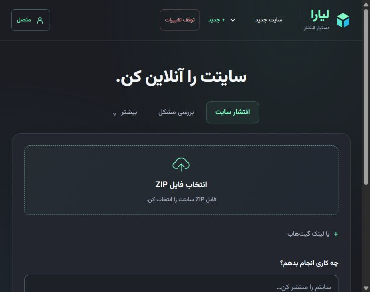

# استقرار واقعی دستیار

در ۲۰۲۶-۱۰-۲۳، پس از تأیید صریح کاربر، خود دستیار روی لیارا منتشر شد:

https://lyara-agent-b1bb00.liara.run/

برنامه در تیم انتخاب‌شده ساخته شد؛ پلن `medium-g2/basic` با رم ۱GB و دیسک `data` به اندازهٔ ۱GB در `/data` دارد. شبکه، دیسک و برنامهٔ تازه با تأیید کاربر ساخته شدند. نسخه‌های اصلاحی روی همین منابع منتشر شدند. ساخت روی زیرساخت لیارا انجام شد.

طبق درخواست بعدی کاربر، `LYARA_PUBLIC_ACCESS=true` فعال است: کادر کد ورود حذف شده و همهٔ بازدیدکنندگان بدون ورود به همان حساب تیم، عملیات و اعتبارش دسترسی دارند. جداسازی حساب یا نقش مستقل هر بازدیدکننده پیاده‌سازی نشده است. برای حالت خصوصی API، اپراتور این گزینه را خاموش می‌کند و `LYARA_ACCESS_TOKEN` را از طریق کلاینت یا درگاه خود در هدر Bearer می‌فرستد؛ رابط دیگر فرم ورود کد ندارد. کلیدهای زیرساخت و مدل همچنان در env سرور هستند و وارد سورس یا Git نشده‌اند.

۱۸ بررسی GET بدون Authorization و کوکی، در سه دور گذشت: صفحه، JavaScript دقیقاً مطابق سورس جدید، تنظیمات، کنترل‌ها، سایت‌ها و سورس‌ها. release فعال پیش از هر دور و پس از آخرین دور با شناسهٔ نسخهٔ جدید تطبیق داده شد. پاسخ لحظه‌ای نسخهٔ قدیمی بلافاصله پس از READY موفقیت حساب نشد؛ بررسی نهایی پس از جابه‌جایی ترافیک انجام شد. وجود و اتصال دیسک نیز از API تأیید شد. این بررسی اثبات پایداری بلندمدت یا بازیابی پس از حادثه نیست.

API ساخت زنده فقط ۲۰ خط در هر صفحه برگرداند. دریافت لاگ اکنون با نشانگر زمانی، حداکثر سه صفحه در هر بررسی و نگهداری ۱۰۰ خط آخر کار می‌کند؛ آزمون رگرسیون رسیدن به خطای انتهای صفحات را پوشش می‌دهد. GET فهرست دیسک از شناسهٔ داخلی برنامه استفاده می‌کند، نه نام نمایشی.

۲۸۸ تست Python و تست Node رابط گذشتند. BoxAPI/Luna در تنظیمات نسخهٔ آنلاین تأیید شد؛ سناریوی مدل جدیدی هنگام استقرار اجرا نشد. دو آزمون واقعی مدلِ مرحلهٔ قبل همان یک سناریوی ساده و یک سخت هستند. انتشار سایت کاربران، خرید سرویس اضافه، تست خرید/حذف داده و تست بار زنده جزو این بررسی نبود.

هزینهٔ نهایی منابع از جمع فرضی قیمت‌ها نتیجه گرفته نشده است؛ مصرف واقعی طبق صورتحساب همان تیم است. جزئیات نسخه، هش و شواهد خلاصه در [رکورد ماشینی](live-deployment.json) ثبت شده‌اند.

نمای نسخهٔ عمومی در مرورگر نیز بررسی شد؛ تصویر ثبت‌شده:

